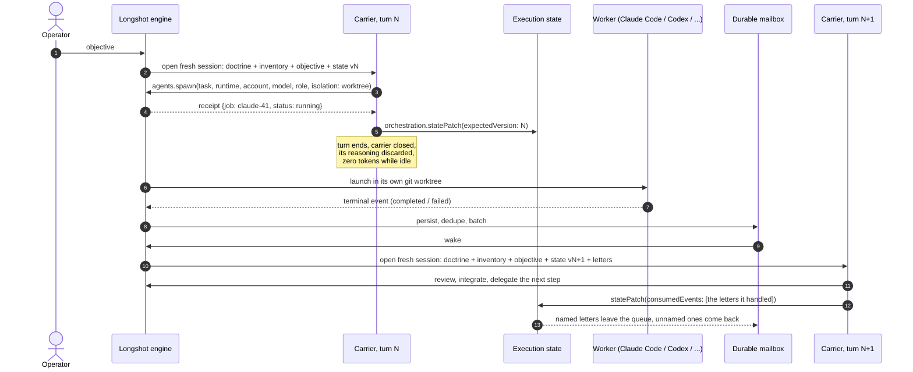

<div align="center">

# Longshot

**One long-lived LLM thread as the engineering lead for a fleet of CLI coding agents.
It delegates, goes to sleep, and wakes up when the work is done. It keeps that up
for days, not minutes.**


**[Harnesses & services](docs/harnesses.md)** ·
**[Accounts](docs/accounts.md)** ·
**[Telemetry](docs/telemetry.md)** ·
**[SKILL.state](docs/skill-state.md)** ·
**[Architecture](docs/architecture.md)** ·
**[In numbers](docs/numbers.md)** ·
**[Roadmap](docs/roadmap.md)**

</div>

> Binaries on npm, source private. The numbers come from Longshot's own databases.

## Why

Coding agents do well on bounded tasks, but someone still has to dispatch them.
An LLM in that seat usually **blocks** while the workers run, **loses** the work
when its turn ends, or **rots** as every turn replays the whole conversation.
Longshot rests on two ideas:

1. **Work outlives the turn.** `agents.spawn` returns a receipt, not a result.
   The coordinator sleeps at zero tokens. A durable mailbox wakes it when the
   workers finish.
2. **State, not memory.** Each turn opens a fresh session that reads the
   doctrine, the objective and a small typed state, and nothing else. This is
   [SKILL.state](docs/skill-state.md).



## Features

| Feature | What it gives you |
|---|---|
| 🛰️ **Delegate, then sleep** | The coordinator ends its turn after it delegates, and spends zero tokens while the workers run. The results wake it with a new turn. |
| 🧠 **SKILL.state, historyless by default** | Each turn reads a small typed state, not the conversation. On day three the prompt is as small as on day one. |
| 🔀 **Two coordinator backends** | The Codex App Server, or Claude through the Agent SDK. A live thread can move to the other backend or to another account, and its state moves with it. |
| 🧰 **Six worker runners** | Claude Code, Codex CLI, Copilot CLI, opencode, Qoder and PowerShell. A runner that is missing is reported with the reason and routed around. |
| 👥 **Many accounts, live quotas** | `~/.codex-work` becomes `codex:work`. Quotas, plans, models and efforts go into one inventory that every turn carries. |
| 🌿 **A worktree for every writer** | Each writing worker gets its own git worktree and branch. The branch is the deliverable. |
| 📬 **Nothing lost on a crash** | Events are persisted, deduplicated, batched and confirmed letter by letter. A wake-up nobody confirmed comes back. |
| 🧳 **Missions outlive the terminal** | Detach, close the window and attach tomorrow. Recovery finds the workers that died while nobody was watching. |
| 📡 **OpenTelemetry on one switch** | The usage of the coordinator and of every worker goes to your OTLP collector, all with the same labels. Off means off. |
| 🖥️ **An operator TUI** | Project home, chats, worktrees, jobs, the inventory policy, and pickers for backend, account, model, mode and tools. |
| 🔒 **Isolation as a boundary** | Workers inherit none of the operator's settings, hooks or MCP servers. The backend enforces file access, never Longshot. |
| 📦 **`npm i -g`** | One package for six platforms, run as `longshot` or `losh`. |

## Works with your harnesses

| Harness | Coordinator | Worker | Telemetry |
|---|---|---|---|
| **Claude Code** | ✅ | ✅ | native OTel |
| **Codex CLI** | ✅ | ✅ | native OTel |
| **GitHub Copilot CLI** | — | ✅ | `agent.usage` from Longshot |
| **opencode** | — | ✅ | `agent.usage` from Longshot |
| **Qoder CLI** | — | ✅ | `agent.usage` from Longshot |
| **PowerShell 7** | — | ✅ | `agent.usage` from Longshot |

Providers: Anthropic, OpenAI, OpenRouter (or any OpenAI-compatible endpoint),
Ollama (local and cloud), GitHub Copilot, OpenCode, Qoder.
[Full matrix →](docs/harnesses.md)

## Quick start

```sh
npm i -g @longshot-harness/longshot   # public beta; `losh` is the same command
longshot doctor                       # backends, runners, and the backend `start` would pick
longshot inventory                    # discovered accounts, quotas, models, roles
cd your-repo && longshot              # the project home: New chat, recent chats, worktrees
```

You need Node.js 18+ and git. The `codex` backend also needs the Codex CLI on
`PATH`. The `claude` backend needs nothing more: the package ships the Agent SDK.
Without `-backend`, Longshot uses the folder's last backend, then `codex`, then
`claude`.

```text
longshot -c                     continue this folder's latest chat
longshot start -detach          start the engine and leave; it keeps running
longshot attach <missionId>     come back to it
longshot jobs -active           what is running now
longshot state -thread <id>     the execution state that thread's turns read
```

Next: [connect your accounts](docs/accounts.md), then [telemetry](docs/telemetry.md)
if you want it.

## In numbers

6 September – 30 October 2026, on Longshot itself and on a private SaaS monorepo:

| Worker jobs | Task success | Worker-hours | Coordinator threads | Worker tokens | Tests |
|:---:|:---:|:---:|:---:|:---:|:---:|
| **1,018** | **98.8 %** | **128 h** | **66**, up to 11 days long | **2.4 B** | **5,906** |

596 of the 1,018 jobs ran on Longshot's own repository. **Longshot is largely
built by Longshot.** [All figures →](docs/numbers.md)

## Explore

| Page | What is in it |
|---|---|
| [Harnesses & services](docs/harnesses.md) | the full compatibility matrix, models and roles, every service Longshot reaches |
| [Accounts](docs/accounts.md) | several Codex and Claude accounts, OpenRouter, Ollama, Copilot BYOK, `accounts.json` |
| [Telemetry](docs/telemetry.md) | the OpenTelemetry export: the switch, the labels, `agent.usage`, an example stack |
| [SKILL.state](docs/skill-state.md) | the coordinator without a memory: the paper, the state, the rules, what one turn sees |
| [Architecture](docs/architecture.md) | how a subagent is assembled, the engine map, what Longshot deliberately does not do |
| [In numbers](docs/numbers.md) | real usage from six mission databases, and how it was counted |
| [Roadmap](docs/roadmap.md) | what is built and what is next |
| [Reading the diagrams](docs/diagrams.md) | the one vocabulary every flowchart here uses |

**Public beta.** Used daily on Windows 11. Linux is verified in a container.
macOS builds are published but have not been run yet.
