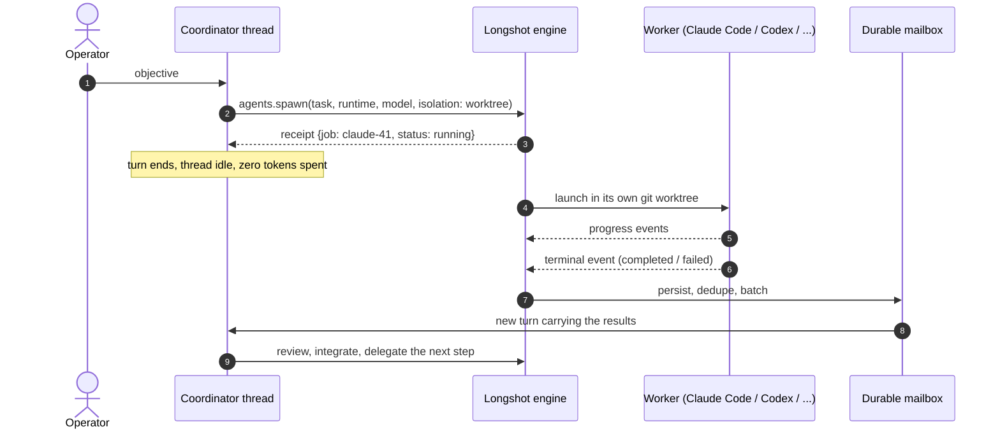
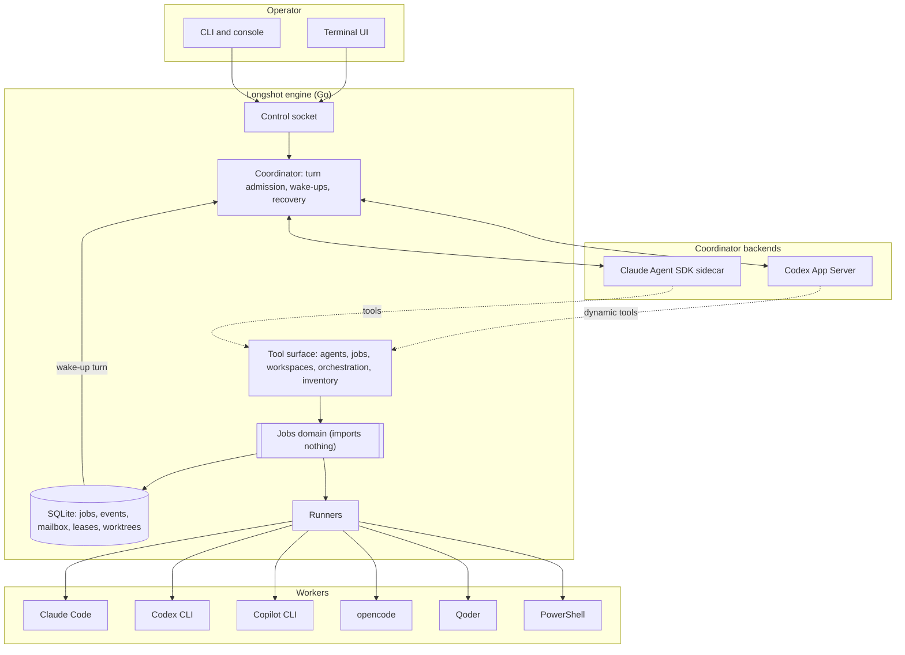
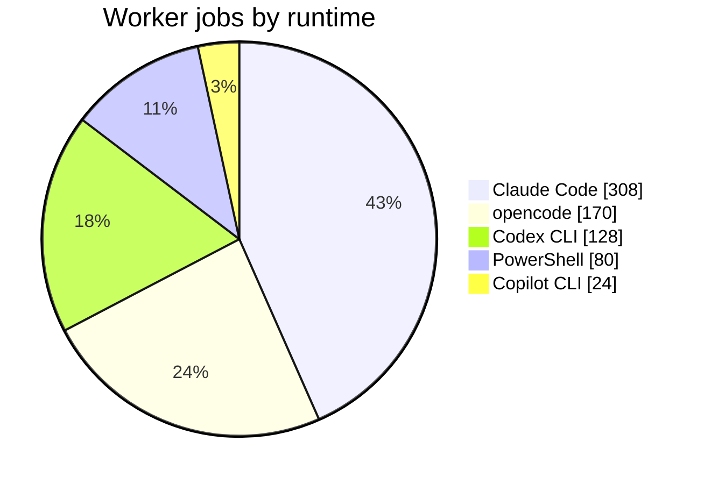
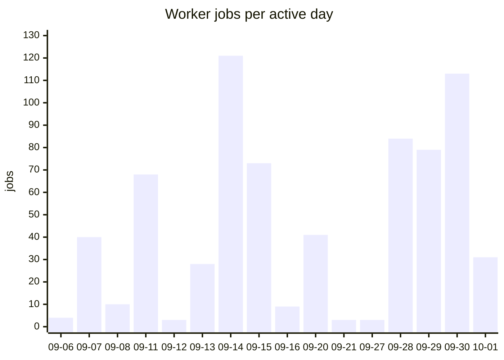

# Longshot

**A local control plane that turns one long-lived LLM thread into the engineering lead
for a fleet of CLI coding agents.**

> The source code is private. This page explains what Longshot is, how it works,
> and what it has done in real use, with numbers taken from its own databases.

---

## The problem

Coding agents such as Claude Code, Codex, Copilot CLI and opencode are good at
bounded tasks. Somebody still has to be the dispatcher: split the objective,
pick an agent, a model and an account with quota left, watch a dozen terminals,
merge the results, and recover when a process dies overnight.

Putting an LLM in the dispatcher seat usually fails in one of two ways.
Either the orchestrator's turn blocks while the workers run, so it burns
context and tokens doing nothing, or the turn ends and the work it started is
lost.

## The idea

> **External work survives the end of the turn that started it.**

The coordinator is a persistent thread, not a loop. When it delegates, the
tool call returns a **receipt**: a job id and `status: running`. It never
returns the result. The coordinator ends its turn and goes idle, and **no
inference runs while it waits**. Workers keep running. Their terminal events
are persisted to a durable mailbox, and Longshot wakes the coordinator with a
**new turn** when results arrive.

## What it does

- **Two coordinator backends.** The coordinator runs either on the Codex App
  Server, spoken over JSON-RPC on stdio with dynamic tools, or on Claude
  through the Agent SDK in a Python sidecar that Longshot spawns and owns. The
  backend belongs to the *thread*, not the process. A live conversation can be
  moved to the other backend, and it carries its transcript with it.
- **Six worker runtimes.** Claude Code, Codex CLI, GitHub Copilot CLI,
  opencode, Qoder and PowerShell. Every runtime is probed at startup. A runtime
  that is missing or not authenticated is reported with a reason, and the
  coordinator routes around it.
- **Multi-account, quota-aware dispatch.** The dispatch inventory lists
  runner accounts, their remaining limits, and the models and reasoning
  efforts each one serves. When a provider refuses work because of quota,
  Longshot records the refusal in the inventory, so the coordinator routes
  later work away from that account until it resets. The same runner can point at several providers, for
  example Claude Code against Anthropic and against local Ollama models.
- **Git worktree isolation.** Each writing worker gets its own worktree and
  branch. The branch is kept as the deliverable, and integration is a
  separate, deliberate step.
- **A durable mailbox.** Events are persisted and deduplicated, then batched
  into one wake-up. Noise is suppressed and failed deliveries are retried, so
  a crash between "worker finished" and "coordinator saw it" loses nothing.
- **Missions that outlive the terminal.** One engine holds a lease on each
  mission, with an OS-held liveness beacon rather than a heartbeat. The
  operator can detach, close the terminal, and attach later. Recovery after a
  crash only touches the mission's own threads, and it detects workers that
  died while nobody was watching.
- **An operator TUI.** A Bubble Tea terminal UI for missions, conversations,
  jobs and inventory, with model and effort pickers and file-access levels,
  plus a line console and `doctor` / `inventory` commands for scripting.
- **A real security boundary.** A worker gets no channel into the
  coordinator's thread and inherits none of the operator's settings, hooks or
  MCP servers. File-access levels are enforced by the backend, never by
  Longshot itself: on Codex an OS sandbox holds them, and on Claude a
  permission mode does.

## Architecture at a glance

The design is hexagonal. The jobs domain imports no other internal package.
Adapters are written against frozen contract files, and the backend port does
not know which LLM vendor sits behind it. An executable test enforces that
dependency direction.

## In numbers

Real usage between **6 September and 1 October 2026**, read from three mission
databases: Longshot building itself, and a private multi-app SaaS monorepo
(Python API, React web app, Go desktop daemon), counting both its main
checkout and one long-running feature worktree.

### Delegation

| KPI | Value |
|---|---|
| Worker jobs delegated | **710** |
| Job success rate | **87 %** (618 completed, 70 failed, 14 cancelled, 8 lost) |
| Worker agent-hours | **105 h** |
| Job duration, median / p90 / longest | 5 min / 19 min / 3.1 h |
| Peak parallel workers | **6** |
| Peak jobs in one day | **121** |
| Jobs fanned out from a single coordinator thread | up to **225** |
| Isolated git worktrees created | **240** |
| Distinct worker models used | **18**, across 5 runtimes |
| Runner accounts in the inventory | **10** (4 Codex, 2 Claude Code, and one each for the rest) |

### The asynchronous loop

| KPI | Value |
|---|---|
| Coordinator threads | **39** (24 on Codex, 15 on Claude) |
| Coordinator wake-ups driven by worker results | **640** confirmed, out of 710 attempted |
| Mailbox events persisted | **8,028** (7,351 delivered, 575 suppressed as noise) |
| Longest-lived coordinator thread | **≈ 11 days** (262 h from first to last turn) |
| Engine sessions | **54**, 219 h in total |
| Longest uninterrupted engine session | **35 h** |

### Tokens

| KPI | Value |
|---|---|
| Claude Code worker tokens | **1.22 B**, of which 97 % were prompt-cache reads |
| Claude Code agent turns | **14,997**, up to 259 in a single job |
| Largest single job | 90 M tokens |
| Claude Code API list-price equivalent | ≈ $757 |
| Codex CLI worker tokens | 17.9 M |

### The codebase

| KPI | Value |
|---|---|
| Commits | **474** in 36 days |
| Go, production | ≈ 89 k lines in 34 packages |
| Go, tests | ≈ 121 k lines, **4,183 tests passing** |
| Direct dependencies | 4, all pure Go (no cgo) |
| Design docs, specs and task records | ≈ 120 k lines of Markdown, with the interface sentences pinned by tests |

About half of the delegated jobs, 356 of 710, ran against Longshot's own
repository. **Longshot is largely built by Longshot.**

How these numbers were counted

- **Job.** One delegated worker process. Durations run from start to end and
  leave out `lost` jobs, whose end time is only when recovery noticed them.
- **Wake-up.** A coordinator turn that Longshot started to deliver worker
  results. One wake-up can carry several batched events.
- **Engine session.** One mission lease: one engine process holding a
  mission from start to exit.
- **Thread lifetime.** The time from a thread's creation to its last
  activity. Most of that time is idle by design.
- **Tokens.** Read from each worker's own final usage report: Claude Code's
  `result` event and Codex CLI's `tokens used` line. opencode, Copilot and
  shell workers report no usage, and the coordinator's own tokens are not
  included. The list-price figure is what Claude Code itself reports, not
  money spent.
- Peak parallelism is counted across all three databases together.

## What it deliberately does not do

- Fork Codex or implement a model runtime.
- Keep a turn open while external work runs. There is no `wait_for` tool, by
  design.
- Parse worker stdout as a protocol. Structured job events are the protocol,
  and stdout is only a transcript.
- Let a worker reach into the coordinator, or relax isolation for
  convenience.

## Status and roadmap

**Work in progress.** It already runs real projects, as the numbers above show. Windows 11 is the
only platform it has been exercised on, although nothing in the code is
Windows-only.

**Built:**

- the coordinator host with two backends
- asynchronous workers with durable wake-ups
- six runners with live capability probing
- the multi-account inventory
- the git worktree lifecycle
- missions with detach and attach
- the operator TUI
- end-to-end live tests and hand-run live drills against real coordinators

**Next:**

- persisted task graphs with dependency constraints
- model routing and retry policies driven by the inventory
- worker pools
- interactive, multi-turn worker control
- human approval nodes
