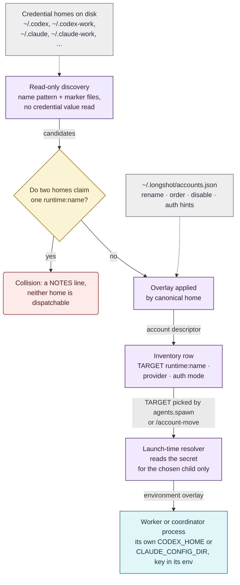
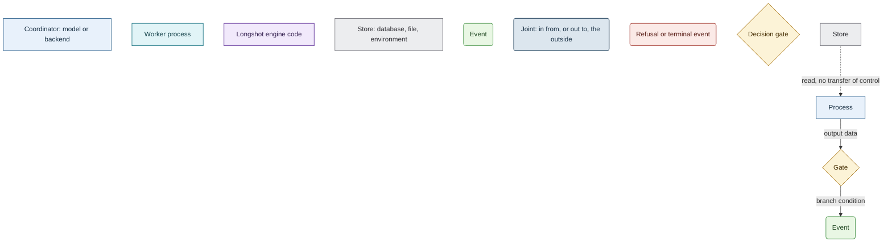
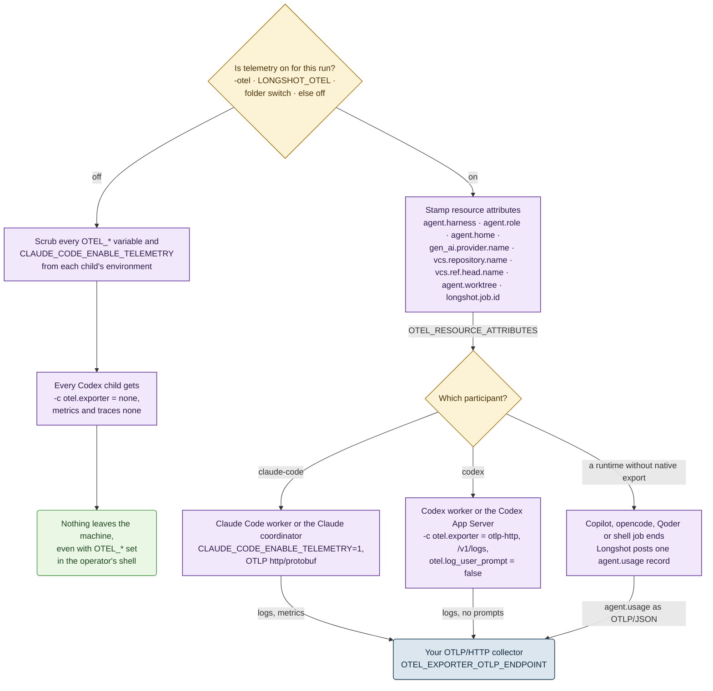
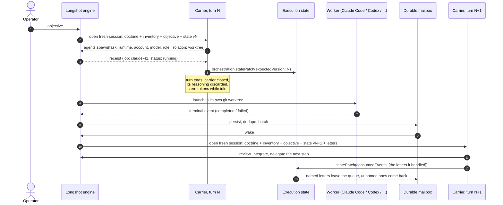
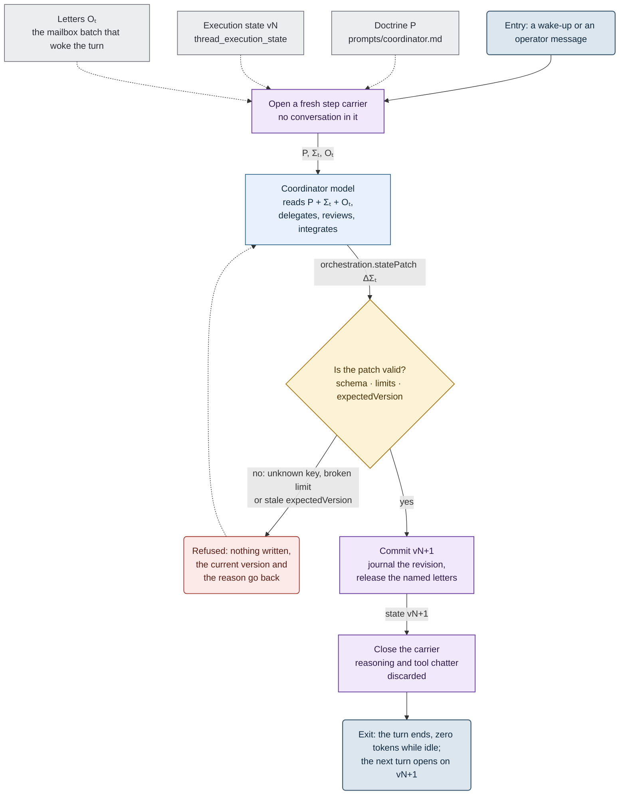
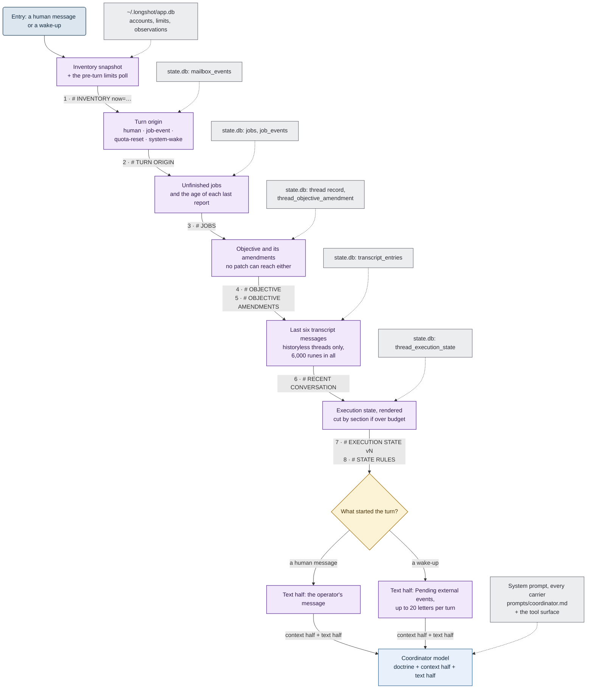
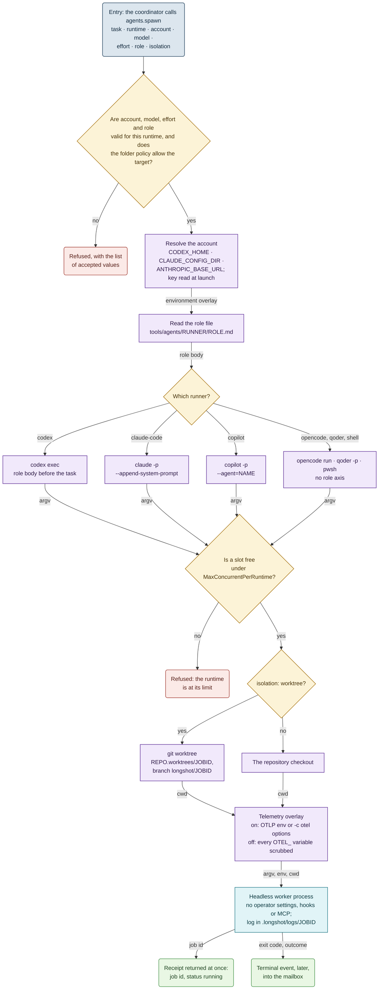
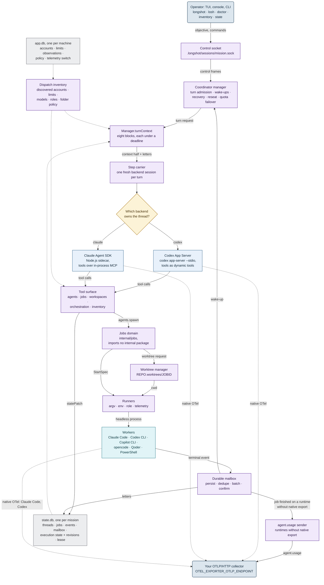
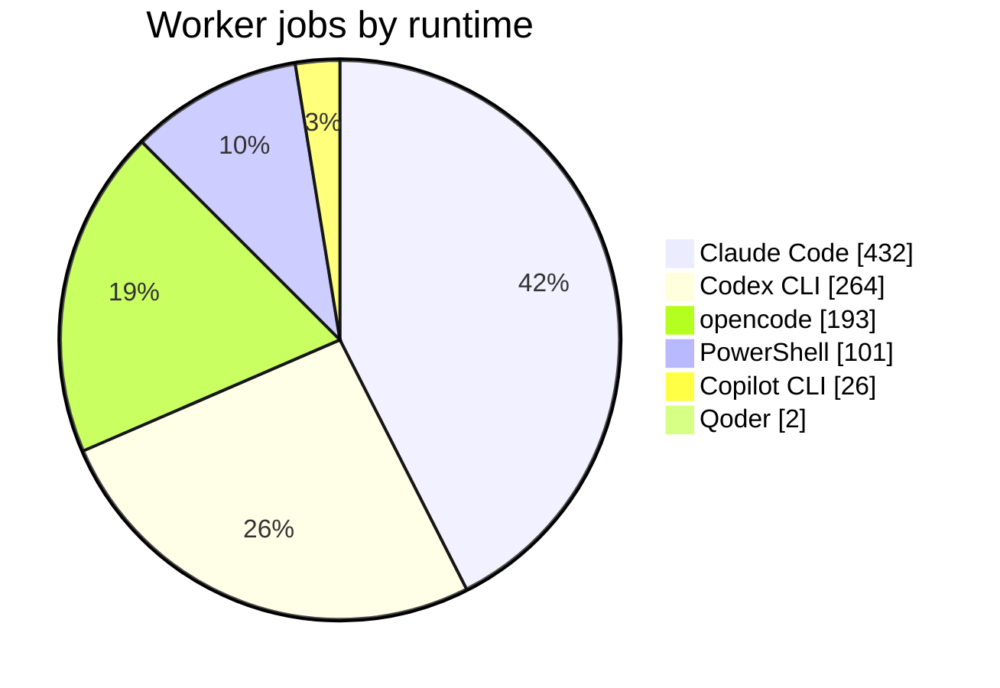
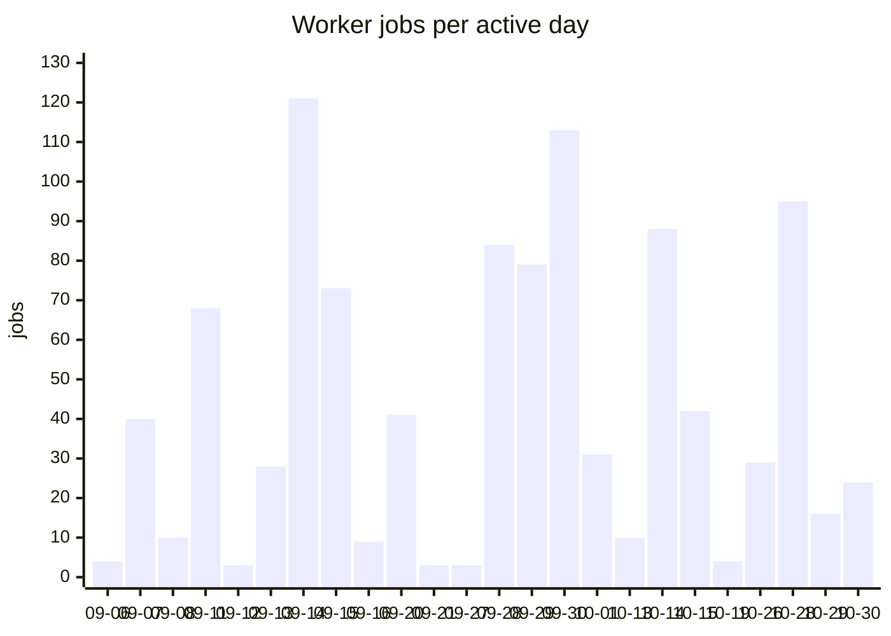

<div align="center">

# Longshot

**One long-lived LLM thread as the engineering lead for a fleet of CLI coding agents.
It delegates, goes to sleep, and wakes up when the work is done. It keeps that up
for days, not minutes.**


</div>

> **The binaries are on npm. The source is private.** This page covers what Longshot
> does, which harnesses and services it works with, how to connect accounts and
> telemetry, how it works inside, and what it has done in real use. The usage
> numbers come from its own databases.

**Contents:**
[Features](#features) ·
[Harnesses](#works-with-your-harnesses) ·
[Services](#supported-services) ·
[Quick start](#quick-start) ·
[Accounts](#connect-your-accounts) ·
[Telemetry](#telemetry-opentelemetry) ·
[The problem](#the-problem) ·
[Two ideas](#two-ideas) ·
[SKILL.state](#skillstate-a-coordinator-without-a-memory) ·
[One turn](#what-one-turn-sees) ·
[Subagents](#how-a-subagent-is-assembled) ·
[Architecture](#architecture) ·
[In numbers](#in-numbers) ·
[Roadmap](#status-and-roadmap)

---

## Features

| Feature | What it gives you |
|---|---|
| 🛰️ **Delegate, then sleep** | `agents.spawn` returns a receipt, never a result. The coordinator ends its turn and spends zero tokens while the workers run. A durable mailbox wakes it with a new turn when they finish. |
| 🧠 **SKILL.state, historyless by default** | Every turn opens a fresh backend session. That session reads the doctrine, the objective and a small typed execution state, not the conversation. On day three the prompt is as small as on day one. |
| 🔀 **Two coordinator backends** | The Codex App Server, or Claude through the Agent SDK. A live thread can move to the other backend or to another account, and its state moves with it. |
| 🧰 **Six worker runners** | Claude Code, Codex CLI, Copilot CLI, opencode, Qoder and PowerShell, each probed at startup. A runner that is missing is reported with the reason, and the coordinator routes around it. |
| 👥 **Many accounts, live quotas** | Longshot finds credential homes on disk: `~/.codex-work` becomes `codex:work`. Quota windows, plans, models and efforts go into one inventory that every turn carries. A spent pool reads `limited` until its window resets. |
| 🌿 **A worktree for every writer** | Each writing worker gets its own git worktree and branch beside the repository. The branch is the deliverable. Merging it is a separate, deliberate step. |
| 📬 **Nothing lost on a crash** | Events are persisted, deduplicated, batched and confirmed letter by letter. If the coordinator did not confirm a wake-up, the wake-up comes back. |
| 🧳 **Missions outlive the terminal** | Detach, close the window and attach tomorrow. One engine holds a lease on the mission, proved by an OS-held beacon. Recovery finds the workers that died while nobody was watching. |
| 📡 **OpenTelemetry on one switch** | A flag, an environment variable or a per-folder toggle sends the usage of the coordinator and of every worker to your OTLP collector, all with the same labels. Off means off. |
| 🖥️ **An operator TUI** | Project home, chats, worktrees, jobs and the inventory policy. Pickers for backend, account, model and effort, mode and tools. Messages carry time stamps. There is also a line console, plus `doctor`, `inventory` and `state` for scripts. |
| 🔒 **Isolation as a boundary** | A worker inherits none of the operator's settings, hooks or MCP servers, and it never sees the coordinator's thread. The backend enforces file access. Longshot never claims a boundary it cannot hold. |
| 📦 **`npm i -g`** | One package for six platforms, run as `longshot` or `losh`. The Claude backend needs nothing beyond Node.js. |

## Works with your harnesses

Longshot does not replace your coding agents. It drives the CLIs you already have,
headless, each on the account you choose.

| Harness | As coordinator | As worker | Accounts | Role delivery | Telemetry |
|---|---|---|---|---|---|
| **Claude Code** | ✅ Agent SDK in a Node.js sidecar; Longshot's tools over an in-process MCP server | ✅ `claude -p` | many: one `CLAUDE_CONFIG_DIR` each, plus an Ollama route | `--append-system-prompt` | native OTel: logs and metrics |
| **Codex CLI** | ✅ `codex app-server`; Longshot's tools as dynamic tools | ✅ `codex exec` | many: one `CODEX_HOME` each | role body put in front of the task | native OTel: logs |
| **GitHub Copilot CLI** | — | ✅ `copilot -p` | one, or a BYOK endpoint | `--agent=NAME` | one `agent.usage` record per job, sent by Longshot |
| **opencode** | — | ✅ `opencode run` | one global auth store | — | one `agent.usage` record per job, sent by Longshot |
| **Qoder CLI** | — | ✅ headless `-p` | one | — | one `agent.usage` record per job, sent by Longshot |
| **PowerShell 7** | — | ✅ runtime `shell`: commands, scripts, builds, tests | `shell:local` | — | one `agent.usage` record per job, sent by Longshot |

- **Coordinator models** come from the backend itself: Codex `model/list`, and
  the Claude CLI's `initialize`.
- **Worker models** are read per account: `model/list` for a ChatGPT home,
  `GET /api/tags` for Ollama, `opencode models` for opencode, and the runner's
  own list otherwise.
- **Roles** are 21 prompt files: 7 for Claude Code, 9 for Codex, 5 for Copilot.
  They define 11 distinct roles, from `planner` and `code-implementer` to
  `reviewer`, `verifier` and `integration-resolver`. A role file is read at
  spawn time, so an edit applies to the next spawn.

## Supported services

| Service | What it is to Longshot | Reached through | Inventory row |
|---|---|---|---|
| **Anthropic** | model provider: a Claude subscription or an API key | Claude Code workers, the Claude coordinator | `claude:default`, `claude:<name>` |
| **OpenAI**, ChatGPT plans | model provider, with live quota windows and plan | Codex workers, the Codex coordinator | `codex:default`, `codex:<name>` |
| **OpenRouter**, or any OpenAI-compatible endpoint | model provider with an API key | a Codex home whose `config.toml` declares the provider | `codex:openrouter` |
| **Ollama**, local models and `:cloud` models | model provider; models, tool support and context read from `/api/tags` | Claude Code, Copilot BYOK, Codex `--oss` | `claude:ollama`, `copilot:byok` |
| **GitHub Copilot** | model provider, counted in premium requests | Copilot CLI | `copilot:default` |
| **OpenCode** providers | model provider behind opencode's own auth store | opencode | `opencode:default` |
| **Qoder** | model provider | Qoder CLI | `qoder:default` |
| **OpenTelemetry** | any OTLP/HTTP collector, for logs and metrics | `OTEL_EXPORTER_OTLP_ENDPOINT` | — |
| **Git** | worktree isolation, one branch per job | `git worktree` | — |
| **npm** | distribution for win32, linux and darwin, each on x64 and arm64 | `@longshot-harness/longshot` | — |

## Quick start

```sh
npm i -g @longshot-harness/longshot   # public beta; `losh` is the same command
longshot doctor                       # backends, runners, and the backend `start` would pick
longshot inventory                    # discovered accounts, quotas, models, roles
cd your-repo && longshot              # the project home: New chat, recent chats, worktrees
```

You need Node.js 18+ and git. For the coordinator backend, `codex` needs the Codex
CLI on `PATH`, and `claude` needs nothing more: the package brings the Agent SDK
and the `claude` binary. Without `-backend`, Longshot picks the backend itself:
the one this folder's last chat used, then `codex`, then `claude`, the first
this machine can run. It names any backend it skips.

```text
longshot -c                     continue this folder's latest chat
longshot start -detach          start the engine and leave; it keeps running
longshot attach <missionId>     come back to it
longshot jobs -active           what is running now
longshot state -thread <id>     the execution state that thread's turns read
```

Longshot runs daily on Windows 11. The Linux build is verified in a container.
The macOS builds are published but have not been run yet.

## Connect your accounts

**An account is a credential home on disk.** Longshot discovers homes read-only,
names each one after its directory, and stores only the authentication *mode*.
It never stores a key, a token or the path to a key file. A secret is read just
before Longshot launches the one child process that needs it, and only that
child's environment receives it.



<details>
<summary><b>How to read the diagrams</b></summary>

Every flowchart on this page uses one fixed vocabulary: eight classes, one
palette. A rectangle is something that *acts*, and its colour says who acts. A
rounded box is a *state reached*, and its colour says whether the flow goes on,
leaves the diagram, or stops. A label on an edge out of a gate is the condition
for that branch. A label on an edge out of a process is the data it hands on. A
dashed edge is a read that does not pass control.



</details>

### Codex: one `CODEX_HOME` per account

```powershell
New-Item -ItemType Directory "$HOME\.codex-work" | Out-Null
$env:CODEX_HOME = "$HOME\.codex-work"; codex login      # becomes codex:work
Remove-Item Env:CODEX_HOME                               # the plain ~/.codex stays codex:default
```

```sh
mkdir -p ~/.codex-personal && CODEX_HOME=~/.codex-personal codex login   # codex:personal
```

A home logged in with ChatGPT reports its plan and its quota windows. They appear
in `USE%`, `RESETS` and `PLAN`, read live through a short-lived App Server that
spends no inference. Longshot recognises a directory as a Codex home when it
matches `.codex*` and holds `config.toml`, `auth.json`, `AGENTS.md` or
`sessions`.

### Codex on OpenRouter, or any API-key provider

Declare the provider in the home's own `config.toml`. Longshot reads the
provider's name and the *name* of its key variable, and nothing else:

```toml
# ~/.codex-openrouter/config.toml
model_provider = "openrouter"
model = "openai/gpt-4.1"
model_reasoning_effort = "high"
preferred_auth_method = "api-key"

[model_providers.openrouter]
name = "OpenRouter"
base_url = "https://openrouter.ai/api/v1"
env_key = "OPENROUTER_API_KEY"
requires_openai_auth = false
```

The row reads `codex:openrouter  openrouter  …  api-key`. The key stays in your
environment, and only the child that runs on this account receives it.

### Claude Code: one `CLAUDE_CONFIG_DIR` per account

```sh
CLAUDE_CONFIG_DIR=~/.claude-work claude      # run /login once, and it becomes claude:work
```

The plain `~/.claude` is `claude:default`. Longshot launches it by *removing*
`CLAUDE_CONFIG_DIR`, so it never inherits whatever the parent shell exported.
Every other `claude:<name>` pins its own home, for the workers and for the Claude
coordinator alike. A Claude row stays `unknown` until a launch on that account
proves its credentials. Its quota prints `-`, because Claude has no quota
channel yet.

### Claude Code on Ollama, local or cloud

```sh
ollama serve       # or set OLLAMA_HOST, or ANTHROPIC_BASE_URL for another Anthropic-compatible endpoint
```

The route `claude:ollama` appears when one of three things is true:
`ANTHROPIC_BASE_URL` is set, `OLLAMA_HOST` is set, or `ollama` is on `PATH`
(then the default `http://localhost:11434`). Models come from `/api/tags`,
`:cloud` models included, each with its tool support and context size. A worker
on this route gets the base URL, and its `ANTHROPIC_API_KEY` is blanked on
purpose. A worker pointed at a third-party endpoint must never fall back on your
Anthropic key.

### Copilot, opencode, Qoder, shell

| Runner | Connect | Row |
|---|---|---|
| Copilot CLI | `copilot`, then `/login` | `copilot:default` |
| Copilot CLI, BYOK | set `COPILOT_PROVIDER_BASE_URL` | `copilot:byok` |
| opencode | `opencode auth login`; one global auth store, one account | `opencode:default` |
| Qoder CLI | `/login`, or `QODER_PERSONAL_ACCESS_TOKEN` | `qoder:default` |
| PowerShell 7 | nothing to connect | `shell:local` |

### Rename, reorder, switch off: `accounts.json`

The file `~/.longshot/accounts.json` (`LONGSHOT_HOME` moves it) is an overlay,
not a registry. It can enrich only a home that discovery has already found. An
entry for a home that does not exist becomes a `NOTES` line, not a row.

```json
{
  "searchDirectories": ["${userHome}"],
  "accounts": [
    { "runtime": "codex", "home": "${userHome}/.codex-work", "name": "office",
      "display": "Office account", "order": 1, "reasoningEffort": "medium" },
    { "runtime": "codex", "home": "${userHome}/.codex-personal", "enabled": false },
    { "runtime": "codex", "home": "${userHome}/.codex-openrouter",
      "auth": { "mode": "api-key", "envVar": "OPENROUTER_API_KEY" } }
  ]
}
```

### Check what Longshot sees

```text
$ longshot inventory
# INVENTORY  now=14:22Z fresh=0m digest=d524
# legend  -=not applicable  ?=no data  times UTC  +Nm only on limited rows
# BEST_FOR: operator hint from config/model-hints.csv; empty means allowed, just not recommended.

## ACCOUNTS
TARGET            PROVIDER    STATUS   AUTH     USE%    RESETS       PLAN  MODELS
claude:default    anthropic   ok       oauth    -       -            -     ?
codex:default     chatgpt     ok       chatgpt  12/7    -            plus  gpt-5.6-sol
codex:openrouter  openrouter  ok       api-key  -       -            -     ?
codex:work        chatgpt     limited  chatgpt  100/74  15:40Z +78m  pro   gpt-5.6-sol
copilot:byok      ollama      down     byok     -       -            -     llama3:tools
shell:local       -           ok       none     -       -            -     -
```

The coordinator spends the same pools. A thread is born on a
`(backend, account)` pair. `/account-move` reseats an open thread onto another
account of the same backend, and `/backend-move` crosses to the other backend.
**Repository setup** decides which targets a folder allows. **Chat inventory &
fallback** orders a chat's routes and can switch on **Auto on quota**. With it
on, a route whose quota is authoritatively spent hands the thread to the next
allowed route, and the thread does not pause.

## Telemetry (OpenTelemetry)

Telemetry is off by default. There are three ways to turn it on:

- `longshot -otel`, for one run;
- `LONGSHOT_OTEL=1` in the environment;
- **Repository setup → Telemetry**, saved per folder.

The flag wins over the variable, the variable wins over the folder's saved
switch, and with none of them telemetry is off. `-otel=false` silences a folder
that is saved on, for one run. The endpoint is the standard
`OTEL_EXPORTER_OTLP_ENDPOINT`, by default `http://127.0.0.1:4318`. Longshot adds
no variable of its own for it.



- **Off really means off.** Off is not "nothing configured". Longshot silences
  every child, so an OpenTelemetry setting inherited from the operator's shell
  cannot leak out of a worker either.
- **One set of labels.** Every participant carries the same resource attributes,
  so one query can split usage by `agent.role` (`coordinator` or `job`), by
  `agent.home` (`codex:work`, `claude:ollama`, …), by repository and branch.
  Attributes already in your `OTEL_RESOURCE_ATTRIBUTES` are kept, so a run of
  yours can carry its own `task.id`.
- **No silent gaps.** Claude Code and Codex export their own usage. A runner
  without native export still yields one `agent.usage` record per finished job.
  A job Longshot cannot measure is marked `usage.status=unavailable` with a
  `usage.reason`. A dashboard can then count the participants without usage
  instead of showing them as zero.
- **The header tells the truth.** A chat shows `otel` while its coordinator
  exports. It shows `otel pending` or `otel off pending` while the coordinator
  still runs with the other value. New jobs follow the switch at once. A running
  coordinator follows it from its next process.

A minimal stack for one machine, as an example layout:

```sh
docker run -d --name lgtm -p 3000:3000 -p 4318:4318 grafana/otel-lgtm   # Grafana + Loki + Prometheus
OTEL_RESOURCE_ATTRIBUTES="task.id=release-42" longshot -otel            # your own label rides along
```

```logql
{service_name="longshot"} | event_name="agent.usage" | usage_status="unavailable"
```

---

## The problem

Coding agents such as Claude Code, Codex, Copilot CLI and opencode do well on
bounded tasks. Somebody still has to dispatch the work. That person splits the
objective, picks an agent, a model and an account with quota left, watches a
dozen terminals, merges the results, and recovers when a process dies overnight.

Put an LLM in the dispatcher's seat, and it usually fails in one of three ways:

1. **The turn blocks.** The orchestrator waits while the workers run, and it
   burns context and tokens doing nothing.
2. **The work is lost.** The turn ends, and whatever it started dies with it.
3. **The context rots.** The orchestrator survives, but every turn is replayed
   on top of the whole conversation so far. After a day the prompt is mostly
   stale observations, and each turn costs more than the last. The model
   re-orients by re-reading its own history.

Longshot is built so that none of the three can happen.

## Two ideas

### 1. External work survives the end of the turn that started it

The coordinator is a persistent thread, not a loop. When it delegates, the tool
call returns a **receipt**: a job id and `status: running`, never the result.
The coordinator ends its turn and goes idle, and **no inference runs while it
waits**. The workers keep running. Their terminal events are persisted to a
durable mailbox, and Longshot wakes the coordinator with a **new turn** when the
results arrive.

### 2. The coordinator does not remember; it keeps state

Every turn runs on a **fresh backend session** with no history in it. What the
next turn needs is written, explicitly and validated, into a small typed
**execution state** that Longshot owns. The model receives the procedure, the
state and the latest observation, and nothing else. This is the
[SKILL.state](#skillstate-a-coordinator-without-a-memory) paradigm. It is the
default for every new coordinator thread, on **both** backends.



## SKILL.state: a coordinator without a memory

### Why

A coordinator that lives for days is idle most of that time:

```text
turn → delegate → END TURN → (idle: minutes, hours) → woken by events → turn → ...
```

The wake-up path worked from the start. **The memory of the step did not.**
Every turn ran on top of the backend's accumulated conversation. Who got which
task, what had been verified, which decisions had been taken and why: all of it
lived only in the context. A wake-up after an hour of silence was read together
with twenty stale observations, and the prompt grew with every turn.

The research paper behind this work, *SKILL.state: Scalable Long-Horizon Agent
Skills* (arXiv:2608.26263), names the problem and measures its price. With an
append-only history, the context at step `t` is `O(t)`, and the total over `T`
steps is `O(T²)` tokens. With an explicit state, each step costs `O(1)`, and the
total is `O(T)`. The paper's own measurements:

| At horizon `T = 100` | History runtime | State runtime |
|---|---|---|
| Total tokens | 1,062,387 | **65,408** |
| Steps to recover after the external world drifts | 5–8 | **0** |

The paper proposes this: at every step, the model receives **only** the
procedural specification `P`, the current structured state `Σₜ` and the latest
observation `Oₜ`. Intermediate reasoning is thrown away as soon as a validated
state update lands.

### How Longshot maps it

| The paper | Longshot |
|---|---|
| procedural spec `P` | the coordinator **doctrine**, `prompts/coordinator.md`, sent byte-identical to every carrier |
| state `Σₜ` | the **execution state**: one typed, versioned JSON document per thread, owned by the runtime |
| state patch `ΔΣₜ` | `orchestration.statePatch`: a dictionary of section replacements, where `null` clears a section |
| step | one coordinator **turn** |
| observation `Oₜ` | the wake: one or more mailbox letters, plus the turn context |
| discarded reasoning | the **step carrier**: a backend session opened for one turn and closed after it |

The mode is a property of the **thread**, like its backend and its account. It is
fixed when the thread is born. For the next new thread, the operator chooses it
with one key in the TUI: `historyless`, the default, or *full history*.



### What the state holds

Schema v1 has nine sections, and it is **bounded by design**. A state that grew
with the number of turns would put back exactly what the paradigm takes out.

| Section | What goes in | Bound |
|---|---|---|
| `phase` | `investigate` → `plan` → `delegate` → `verify` → `report` | enum |
| `plan` | steps with `id`, `goal`, `status` and `dependsOn`; failed steps are kept, so nobody retries them blindly | 64 items |
| `decisions` | named conclusions, so that a later turn does not reopen them, and open questions as `asked:<topic>` | — |
| `notes` | conclusions, never the path to them; the runtime appends and numbers them | 16 × 256 runes |
| `blockers` | what the work waits on, by reference (`job:claude-42`) | — |
| `verification` | checks and their outcome | — |
| `artifactRefs` | branches, files and commits, as references, not copies | — |
| `nextActions` | what the next turn should do | 32 |
| `consumedEvents` | the `EventID` of every letter this turn handled | 64 |
| *any string* | | 512 runes |
| *whole document* | compact JSON | **128 Ki runes** |

The document bound started at 8,192 characters. Real threads reached 8,187 of
it, so the bound went up to 128 Ki runes. That is still a constant, not a
function of the number of turns. If a rendered block ever runs over budget, its
sections are cut in a fixed order and the header says so.

What a turn actually reads:

```text
# EXECUTION STATE v7

schemaVersion: 1
phase: delegate
consumedEvents: 2 ids in the current list

## plan
- S1 done: map the schema
- S2 running: migrate the users table (depends on: S1)

## decisions
- storage = sqlite

## notes
- #2 S2: migration must run before the API deploy
- #1 S1: the users table has no index on email

## blockers
- B1: waiting for the migration job (waiting on: job:claude-42)

## verification
- V1 pending: go test ./...

## artifactRefs
- branch: longshot/claude-42
```

### The rules that make it hold

- **Patch or lose it.** State reaches the next turn only through
  `orchestration.statePatch`. Nothing parses prose back out of an answer.
- **Optimistic concurrency.** Every patch names its `expectedVersion`. A patch
  with a stale version is refused with the current one, and nothing is written.
- **All or nothing.** An unknown key or a broken limit refuses the whole patch.
  There is no partial write. Every refusal is recorded together with the reason
  the model was given.
- **Every version is kept.** `orchestration.stateHistory` answers the question
  *"why does the plan look like this?"*, and the model does not have to
  reconstruct its own reasons.
- **Reference, never copy.** Jobs, worktrees, accounts and quotas belong to
  their own stores, and they change while the coordinator sleeps. The state
  points at them (`wait:claude-42`), and the store holds the fact. When the two
  disagree, the store wins, and `orchestration.status` names the disagreement.
- **Handling is proved, not assumed.** A mailbox letter leaves the queue only
  when a turn names its `EventID` in `consumedEvents`. A turn that crashes, or
  forgets, gets the letter again. Atomicity moved from the transport to the
  state.
- **A question is state.** A turn that asks the operator something records the
  question in `decisions` as `asked:<topic>`, with its options. An answer like
  `1a 3b` then still resolves turns later, in a session that never saw the
  question. `# RECENT CONVERSATION`, the last six messages, is the backstop for
  a turn that forgot.
- **The objective is not state.** It arrives as its own block, in the operator's
  words, and no patch can reach it. A redirection is recorded with
  `orchestration.objective` as `clarify` or `replace`. The reason and the
  previous wording are kept beside it.
- **No native subagents.** Work that a backend spawns inside a carrier would die
  with the carrier, so every delegation goes through `agents.spawn`. On Claude,
  the vendor's `Agent` and `Task` tools are withheld from the carrier outright.
- **A carrier is never resumed.** After a restart, a crash or a move to another
  backend, the next turn opens a new carrier and continues from the state.
  Threads older than the feature got a state derived from Longshot's own stores,
  with a note saying that their earlier reasoning is not in it.

What it buys:

| | Full history | Historyless (SKILL.state) |
|---|---|---|
| Prompt size per turn | grows with every turn | flat: doctrine + context + state |
| Re-orientation after hours idle | re-read the conversation | read one state block |
| Restart in the middle of an objective | resume the backend session, if it survived | open a new carrier and continue |
| Move to another backend or account | replay the transcript | the state moves with the thread |
| Wake-up lost in a crash | possible | the letter comes back until a turn names it |

How it has behaved in use so far:

| Since historyless became the default on 13 October | |
|---|---|
| Historyless coordinator threads | **27** of 66 |
| Execution-state revisions committed | **385** |
| Patches refused by validation, each with the reason the model was told | **34** |
| Objective amendments recorded (`clarify` / `replace`) | **18** |

## What one turn sees

Longshot **assembles the coordinator's context from durable sources on every
turn**, in a fixed order. Nothing in it is remembered. Everything in it is
re-read.



That construction has a few consequences:

- **The model has a clock.** The inventory header carries `now=`, so a thread
  that slept for six hours knows it.
- **Progress without noise.** Running workers report only through `# JOBS`.
  Intermediate progress events are recorded, but they do not wake the
  coordinator.
- **A failed source costs a line, not a turn.** Every block is read under a
  deadline. A missing inventory degrades to a one-line notice, and a block whose
  store is absent is simply not rendered.
- **Batched wake-ups.** Up to twenty letters ride one turn. The batch window
  counts from the *oldest* waiting letter, so nothing waits forever.
- **The worker's view is separate.** Workers never receive the doctrine, the
  inventory or the execution state. Each one gets a single self-contained task.
- **Lean delegation.** The doctrine and the tool texts no longer prompt the
  model to list the inventory again: what it needs to route is already in the
  turn.

**Next on this path: context fingerprints.** Part of a coordinator's context is
*ambient*. The backend CLI loads skills, plugins, MCP servers and `AGENTS.md`
files by itself, and they differ per backend and per account home. Every
historyless turn opens a new carrier, so an edit there silently changes the
next turn. The planned fingerprint records a canonical hash of both halves on
every turn. Then the question *"what exactly did turn N run on, and what
changed since N-1?"* has an answer.

## How a subagent is assembled

Longshot does not ship a fixed set of agents. The coordinator **composes one for
each task** from independent axes, and each axis is checked against a live
inventory:

```text
subagent = runner + account + model + effort + role + tool grant + workspace/isolation + task
```

| Axis | What it is | Example |
|---|---|---|
| **runner** | the CLI that does the work | Claude Code, Codex CLI, Copilot CLI, opencode, Qoder, PowerShell |
| **account** | one credential set, one quota pool | `codex:work`, `codex:personal`, `claude:work`, `claude:ollama` |
| **model provider** | who serves inference behind that account | Anthropic, ChatGPT, OpenRouter, Ollama (local and cloud), GitHub Copilot |
| **model** + **effort** | what the account offers, and how hard it thinks | `gpt-6.1-sol@high`, `claude-opus-5-5`, `glm-5.3:cloud` |
| **role** | a reusable prompt with no task in it, per runner | `planner`, `code-implementer`, `reviewer`, `verifier`, `integration-resolver` |
| **tool grant** | what the worker may do inside its process | permission mode, allowed tools, sandbox level |
| **isolation** | where it writes | its own git worktree and branch, or read-only in the repository |
| **task** | the self-contained brief | written by the coordinator, following the doctrine |

One runner can sit in front of several providers. Claude Code can run against
Anthropic and against Ollama; Codex can run against ChatGPT and against
OpenRouter. Those are different accounts with different quotas, and the
inventory shows them as separate rows.

### The inventory the coordinator routes on

Before every turn, the coordinator gets the dispatch surface, narrowed to what
the folder's policy allows, in one compact, byte-stable format. The format is
the one `longshot inventory` prints [above](#check-what-longshot-sees), plus a
model table:

```text
## MODELS
MODEL         PROVIDER  EFFORTS          DEF   TOOLS  CTX     BEST_FOR
gpt-5.6-sol   chatgpt   low,medium,high  high  ?      ?
llama3:tools  ollama    -                -     yes    262144
```

- `STATUS` is **derived from what the provider actually did**. A quota refusal
  is recorded as an observation, and the account reads `limited` until its
  window resets. Later work then routes away from it on its own.
- `BEST_FOR` is the operator's note on what a model suits. It lives in a CSV
  file, and Longshot re-reads it without a restart.
- `digest=` lets the coordinator ask *"has anything changed?"* for the price of
  one line.
- `-` means *not applicable*, and `?` means *not known right now*. The two are
  never collapsed into one.

### From `agents.spawn` to a running process



Some deliberate choices in that path:

- **Refuse, never default.** A wrong account, role or effort is refused with the
  accepted values. A silent fallback would only move a failure from a cheap
  moment to an expensive one.
- **Enumerate, don't gatekeep.** The model list is a guide, not a whitelist. A
  model newer than any list can still be spawned by name.
- **A quota-limited account is not refused.** The inventory reports facts and
  leaves the routing decision to the coordinator.
- **Roles are read at spawn time.** Edit a role file, and the next spawn uses it.
- **Isolation is a security boundary.** A worker gets no channel into the
  coordinator's thread and inherits none of the operator's settings, hooks or
  MCP servers. Two writing workers never share a checkout. Worktrees live beside
  the repository, not inside it, so they survive a `git clean`.

## Architecture



The design is hexagonal. The jobs domain imports no other internal package.
Adapters are written against frozen contract files. The backend port does not
know which LLM vendor sits behind it, and an executable test enforces that
direction of dependencies. The documentation is tested too. The test suite pins
the sentences of the reference documents that act as interfaces, and it pins the
inventory format byte for byte.

## In numbers

Real usage from **6 September to 30 October 2026**, read from six mission
databases. Three belong to Longshot building itself: its main checkout and two
feature worktrees. The other three belong to a private SaaS monorepo (a Python
API, a React web app and a Go desktop daemon): its main checkout and two feature
worktrees. Historyless mode became the default on 13 October, and OTel export
landed on 30 October.

### Delegation

| KPI | Value |
|---|---|
| Worker jobs delegated | **1,018** |
| Task success rate | **98.8 %**: 886 completed, 11 failed on the task itself, 10 of them shell checks that came back red |
| Stopped before the task could succeed or fail, left out of the rate | 121: 42 refused by the provider (quota, credits, an expired key), 37 hit launch and integration bugs, most of them fixed since, 17 killed by the idle watchdog, 10 lost in engine restarts, 15 cancelled |
| Worker agent-hours | **128 h** |
| Job duration, median / p90 / longest | 4 min / 17 min / 3.1 h |
| Peak parallel workers | **6** |
| Peak jobs in one day | **121** |
| Jobs fanned out from a single coordinator thread | up to **225** |
| Isolated git worktrees created | **326** |
| Distinct worker models used | **26** |
| Runner accounts in the inventory | **11** (4 Codex, 3 Claude Code, and one each for the rest) |





### The asynchronous loop

| KPI | Value |
|---|---|
| Coordinator threads | **66** (47 on Codex, 19 on Claude; 27 historyless) |
| Coordinator wake-ups driven by worker results | **925** confirmed, out of 1,000 attempted |
| Mailbox events persisted | **11,094** (7,707 delivered, 3,269 suppressed as noise, 73 pending, 45 failed) |
| Longest-lived coordinator thread | **≈ 11 days** (263 h from first to last turn) |
| Engine sessions | **107**, 326 h in total |
| Longest uninterrupted engine session | **35 h** |

### Tokens

| KPI | Value |
|---|---|
| Claude Code worker tokens | **1.80 B** in 418 jobs, 97 % of them prompt-cache reads; 38 % served by Ollama models |
| Claude Code agent turns | **21,273**, up to 312 in a single job |
| Largest single job | 90 M tokens |
| Claude Code API list price, Anthropic accounts only | ≈ $699 |
| Codex CLI worker tokens | **588 M** in 205 jobs, 96 % cache reads; 43 more jobs left only a total (6.1 M) |
| Copilot CLI worker tokens | 47 M in 19 jobs, 19 premium requests |
| Coordinator tokens, full-history threads | **549 M** in 21 threads, measured on 15 October (316 M Codex, 233 M Claude) |

### The codebase

| KPI | Value |
|---|---|
| Commits | **687** in 57 days |
| Go, production | ≈ 118 k lines in 36 packages |
| Go, tests | ≈ 176 k lines, **5,906 tests passing** |
| Claude sidecar | ≈ 5 k lines of Node.js on the TypeScript Agent SDK |
| Direct Go dependencies | 5, all pure Go (no cgo) |
| Design docs, specs and task records | ≈ 191 k lines of Markdown, with the interface sentences pinned by tests |

More than half of the delegated jobs, 596 of 1,018, ran against Longshot's own
repository. **Longshot is largely built by Longshot.**

<details>
<summary>How these numbers were counted</summary>

- **Job.** One delegated worker process. Durations run from start to end. They
  leave out `lost` jobs, whose end time only marks when recovery noticed them.
- **Task success rate.** Completed jobs out of the jobs whose task reached an
  outcome. A job that never got that far is classified by the error it left
  and is left out:
  - a provider refusal: quota, credits, an expired key;
  - a launch or integration bug: a brief too long for the command line, a
    wrong role name, a model the account does not serve, missing auth, a CLI
    build that crashed on start, a worktree path that was gone;
  - the idle watchdog, which until mid-September also killed Claude Code
    workers that were silent only because their output was not streamed;
  - an engine restart that lost the worker;
  - a cancellation.

  Counting every unsuccessful job as a failure, the rate is 87.0 %.
- **Wake-up.** A coordinator turn that Longshot started to deliver worker
  results. One wake-up can carry several batched events.
- **Engine session.** One mission lease: one engine process holding a mission
  from start to exit.
- **Thread lifetime.** The time from a thread's creation to its last activity.
  By design, most of that time is idle.
- **Tokens.** Read from what each participant left on disk:
  - Claude Code: the `result` event of the job;
  - Codex: the rollout named in the worker's stderr, or, when that is gone,
    the `tokens used` total;
  - Copilot: the `session.shutdown` event.

  A token count is input plus cache reads plus cache writes plus output.
  Reasoning is part of output. opencode, Qoder and shell workers report no usage.
- **Coordinator tokens.** A full-history thread was read from its Codex rollout
  or its Claude SDK session file. The CLIs have pruned those files since
  15 October, so that row is the figure measured then and is not recomputed. A
  historyless turn runs on a carrier that leaves no session file at all. Its
  usage is now measured per turn, as it happens, through the OTel export.
- **List price.** What Claude Code reports for jobs on Anthropic accounts. It is
  not money spent. Claude Code also prices models it reaches through another
  endpoint, such as Ollama, at Anthropic rates; that figure is left out.
- **Mission databases.** A mission's database lives in its checkout. A feature
  worktree removed since the previous edition took its database with it, and a
  new one joined. That is why a few October days read lower than before.
- **Tests.** Passing test cases, subtests included, in one `go test ./...` run.
  Line counts cover tracked files only, without the vendored Codex checkout and
  the generated schema bundle.
- Peak parallelism is counted across all six databases together.
- Recomputed by [`kpi.py`](kpi.py), next to this page, against the mission
  databases.

</details>

## What it deliberately does not do

- Fork Codex or implement a model runtime.
- Keep a turn open while external work runs. There is no `wait_for` tool, by
  design.
- Carry a coordinator's reasoning from one turn to the next. What survives is
  what was written into the state.
- Parse worker stdout as a protocol. Structured job events are the protocol;
  stdout is only a transcript.
- Hand the execution state, the doctrine or the inventory to a worker.
- Store a credential. The inventory keeps the authentication mode, never a key,
  a token or a path to a key file.
- Send telemetry nobody asked for, or let an inherited `OTEL_*` setting leak
  out of a child process.
- Let a worker reach into the coordinator, or relax isolation for convenience.

## Status and roadmap

**Public beta.** Longshot already runs real projects, as the numbers above
show. It is installed with `npm i -g @longshot-harness/longshot`. Windows 11 is
the platform it runs on every day. Linux is verified in a container. macOS is
built but not yet run.

**Built:**

- the coordinator host: two backends behind one neutral port, chosen
  automatically when none is named
- the historyless execution mode on both backends: step carriers, an execution
  state with validation, versions and history, and per-letter confirmation
- objective amendments, with the reason and the prior wording; questions kept
  as state
- asynchronous workers with durable wake-ups
- six runners with live capability probing
- account discovery from credential homes, with a metadata overlay and secrets
  resolved at launch only
- the multi-account, multi-provider inventory with derived quota status, a
  per-folder policy and automatic coordinator failover on quota
- the Claude sidecar rebuilt on the TypeScript Agent SDK and shipped inside the
  npm package
- OpenTelemetry export for the coordinator and every worker, with a per-folder
  switch and `agent.usage` records for runners without native export
- usage normalisation across Anthropic, Codex and Copilot reports
- the git worktree lifecycle
- missions with detach, attach and relocation
- the operator TUI: project home, chats, worktrees, Repository setup, Chat
  settings
- npm distribution for six platforms
- end-to-end live tests and hand-run live drills against real coordinators

**Next:**

- `longshot usage`: per-job and per-turn accounting, with prices
- coordinator questions answered through the UI (`AskUserQuestion` is still
  refused today)
- context fingerprints: a hash of every turn's assembled and ambient context
- a single `orchestration.step` call that patches the state and acts at once
- a state schema that a mission can extend
- persisted task graphs with dependency constraints
- model routing and retry policies driven by the inventory
- worker pools and interactive, multi-turn worker control
- human approval nodes
