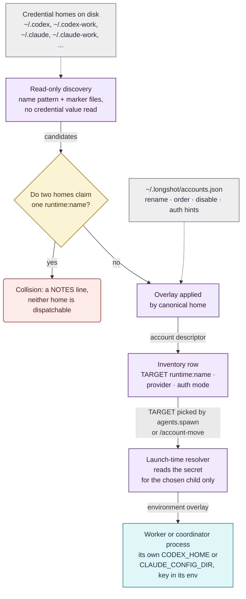

[← Longshot](../README.md) · [Harnesses & services](harnesses.md) · **Accounts** · [Telemetry](telemetry.md) · [SKILL.state](skill-state.md) · [Architecture](architecture.md) · [In numbers](numbers.md) · [Roadmap](roadmap.md)

# Connect your accounts

**An account is a credential home on disk.** Longshot finds homes read-only and names each one
after its directory. It stores only the auth *mode*: never a key, a token or a key path. Only
the one child process that needs a secret receives it, and only at launch.

Diagrams use one [fixed vocabulary](diagrams.md).



## Codex: one `CODEX_HOME` per account

```powershell
New-Item -ItemType Directory "$HOME\.codex-work" | Out-Null
$env:CODEX_HOME = "$HOME\.codex-work"; codex login      # becomes codex:work
Remove-Item Env:CODEX_HOME                               # the plain ~/.codex stays codex:default
```

```sh
mkdir -p ~/.codex-personal && CODEX_HOME=~/.codex-personal codex login   # codex:personal
```

A ChatGPT home reports its plan and quota windows in `USE%`, `RESETS` and `PLAN`. A home is a
directory named `.codex*` that holds `config.toml`, `auth.json`, `AGENTS.md` or `sessions`.

## Codex on OpenRouter, or any API-key provider

Longshot reads the provider and the *name* of its key variable, nothing else:

```toml
# ~/.codex-openrouter/config.toml
model_provider = "openrouter"
model = "openai/gpt-4.1"
model_reasoning_effort = "high"
preferred_auth_method = "api-key"

[model_providers.openrouter]
name = "OpenRouter"
base_url = "https://openrouter.ai/api/v1"
env_key = "OPENROUTER_API_KEY"
requires_openai_auth = false
```

The result is a row `codex:openrouter  openrouter  …  api-key`. The key stays in your
environment.

## Claude Code: one `CLAUDE_CONFIG_DIR` per account

```sh
CLAUDE_CONFIG_DIR=~/.claude-work claude      # run /login once, and it becomes claude:work
```

- `~/.claude` is `claude:default`, launched with `CLAUDE_CONFIG_DIR` *removed*, not inherited.
- Every other `claude:<name>` pins its own home, for workers and for the coordinator.
- A Claude row reads `unknown` until a launch proves its credentials. Its quota is `-`, because
  Claude has no quota channel yet.

## Claude Code on Ollama, local or cloud

```sh
ollama serve       # or set OLLAMA_HOST, or ANTHROPIC_BASE_URL for another Anthropic-compatible endpoint
```

`claude:ollama` appears when `ANTHROPIC_BASE_URL` or `OLLAMA_HOST` is set, or when `ollama` is on
`PATH` (default `http://localhost:11434`). Models, `:cloud` included, come from `/api/tags`.
Workers on this route get `ANTHROPIC_API_KEY` blanked, so they never fall back on your Anthropic
key.

## Copilot, opencode, Qoder, shell

| Runner | Connect | Row |
|---|---|---|
| Copilot CLI | `copilot`, then `/login` | `copilot:default` |
| Copilot CLI, BYOK | set `COPILOT_PROVIDER_BASE_URL` | `copilot:byok` |
| opencode | `opencode auth login` (one global store) | `opencode:default` |
| Qoder CLI | `/login`, or `QODER_PERSONAL_ACCESS_TOKEN` | `qoder:default` |
| PowerShell 7 | nothing | `shell:local` |

## Rename, reorder, switch off: `accounts.json`

The file is `~/.longshot/accounts.json` (`LONGSHOT_HOME` moves it). It is an overlay, not a
registry: it enriches only homes that discovery found. An entry for a missing home becomes a
`NOTES` line.

```json
{
  "searchDirectories": ["${userHome}"],
  "accounts": [
    { "runtime": "codex", "home": "${userHome}/.codex-work", "name": "office",
      "display": "Office account", "order": 1, "reasoningEffort": "medium" },
    { "runtime": "codex", "home": "${userHome}/.codex-personal", "enabled": false },
    { "runtime": "codex", "home": "${userHome}/.codex-openrouter",
      "auth": { "mode": "api-key", "envVar": "OPENROUTER_API_KEY" } }
  ]
}
```

## Check what Longshot sees

```text
$ longshot inventory
# INVENTORY  now=14:22Z fresh=0m digest=d524
# legend  -=not applicable  ?=no data  times UTC  +Nm only on limited rows
# BEST_FOR: operator hint from config/model-hints.csv; empty means allowed, just not recommended.

## ACCOUNTS
TARGET            PROVIDER    STATUS   AUTH     USE%    RESETS       PLAN  MODELS
claude:default    anthropic   ok       oauth    -       -            -     ?
codex:default     chatgpt     ok       chatgpt  12/7    -            plus  gpt-5.6-sol
codex:openrouter  openrouter  ok       api-key  -       -            -     ?
codex:work        chatgpt     limited  chatgpt  100/74  15:40Z +78m  pro   gpt-5.6-sol
copilot:byok      ollama      down     byok     -       -            -     llama3:tools
shell:local       -           ok       none     -       -            -     -
```

## The coordinator uses the same pools

- A thread is born on a `(backend, account)` pair.
- `/account-move` moves an open thread to another account of the same backend.
  `/backend-move` crosses to the other backend.
- **Repository setup** decides which targets a folder allows.
- **Chat inventory & fallback** orders a chat's routes. With **Auto on quota** on, a route
  whose quota is spent hands the thread to the next allowed route instead of pausing it.

---

[← Harnesses & services](harnesses.md) · [Telemetry →](telemetry.md)
