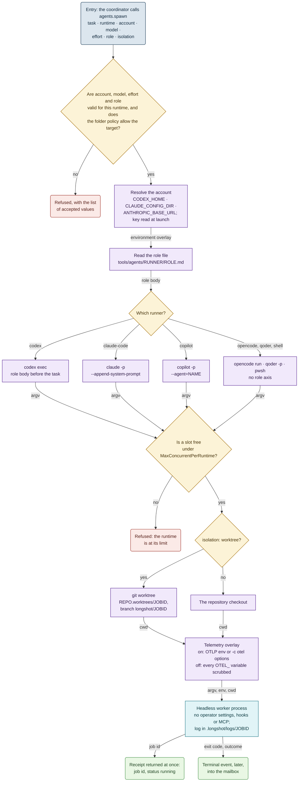
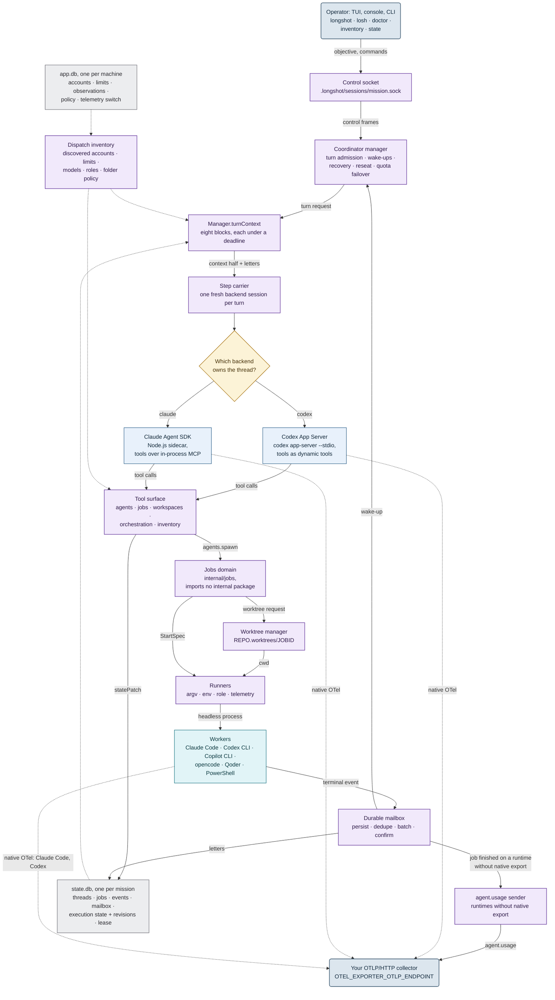

[← Longshot](../README.md) · [Harnesses & services](harnesses.md) · [Accounts](accounts.md) · [Telemetry](telemetry.md) · [SKILL.state](skill-state.md) · **Architecture** · [In numbers](numbers.md) · [Roadmap](roadmap.md)

# Architecture

Diagrams use one [fixed vocabulary](diagrams.md).

## How a subagent is assembled

There is no fixed set of agents. The coordinator composes one per task, and each axis is checked
against the live inventory:

```text
subagent = runner + account + model + effort + role + tool grant + workspace/isolation + task
```

| Axis | What it is | Example |
|---|---|---|
| **runner** | the CLI that does the work | Claude Code, Codex CLI, Copilot CLI, opencode, Qoder, PowerShell |
| **account** | one credential set, one quota pool | `codex:work`, `codex:personal`, `claude:work`, `claude:ollama` |
| **model provider** | who serves inference behind it | Anthropic, ChatGPT, OpenRouter, Ollama, GitHub Copilot |
| **model** + **effort** | what the account offers, how hard it thinks | `gpt-6.1-sol@high`, `claude-opus-5-5`, `glm-5.3:cloud` |
| **role** | a reusable prompt with no task in it | `planner`, `code-implementer`, `reviewer`, `verifier` |
| **tool grant** | what the worker may do in its process | permission mode, allowed tools, sandbox level |
| **isolation** | where it writes | its own worktree and branch, or read-only in the repository |
| **task** | the self-contained brief | written by the coordinator |

The coordinator routes on the inventory, which is narrowed to what the folder allows. The account
rows are on [Accounts](accounts.md#check-what-longshot-sees). The model table:

```text
## MODELS
MODEL         PROVIDER  EFFORTS          DEF   TOOLS  CTX     BEST_FOR
gpt-5.6-sol   chatgpt   low,medium,high  high  ?      ?
llama3:tools  ollama    -                -     yes    262144
```

- `STATUS` comes from what the provider did. After a quota refusal the account reads `limited`
  until its window resets.
- `BEST_FOR` is the operator's note, kept in a CSV file and re-read without a restart.
- `digest=` answers *has anything changed?* in one line. `-` means not applicable, `?` means
  unknown.

## From `agents.spawn` to a running process



- **Refuse, never default.** A wrong axis is refused with the accepted values, never replaced in
  silence.
- **Enumerate, don't gatekeep.** A model newer than any list can still be spawned by name.
- **Report quota, don't refuse it.** Spending a limited account is the coordinator's call.
- **Isolation is a boundary.** Two writers never share a checkout. Worktrees live beside the
  repository and survive `git clean`.

## The engine



The design is hexagonal: the jobs domain imports nothing internal, adapters are written against
frozen contracts, and the backend port is vendor-neutral. A test enforces each of these rules.
The test suite also pins the interface sentences of the documentation, and the inventory format
byte for byte.

## What it deliberately does not do

- Fork Codex or implement a model runtime.
- Keep a turn open while work runs. There is no `wait_for` tool.
- Carry reasoning between turns. Only the state survives.
- Parse worker stdout as a protocol. Job events are the protocol.
- Give a worker the state, the doctrine or the inventory.
- Store a credential. It keeps the auth mode only.
- Send telemetry nobody asked for, or leak an inherited `OTEL_*` setting.
- Let a worker reach into the coordinator, or relax isolation for convenience.

---

[← SKILL.state](skill-state.md) · [In numbers →](numbers.md)
