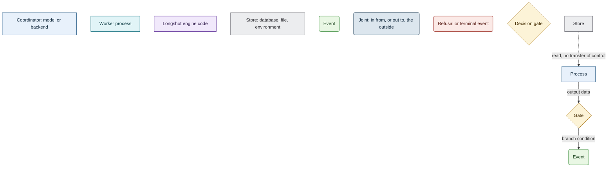

[← Longshot](../README.md) · [Harnesses & services](harnesses.md) · [Accounts](accounts.md) · [Telemetry](telemetry.md) · [SKILL.state](skill-state.md) · [Architecture](architecture.md) · [In numbers](numbers.md) · [Roadmap](roadmap.md)

# Reading the diagrams

Every flowchart here uses the same eight classes and one palette.

- **Rectangle:** something that acts. Its colour says who acts.
- **Rounded box:** a state reached. Its colour says whether the flow goes on, leaves the diagram,
  or stops.
- **Edge label:** a condition when the edge leaves a gate, the data handed on when it leaves a
  process.
- **Dashed edge:** a read that passes no control.

Sequence diagrams and charts are not flowcharts and do not use these classes.

---

[← Longshot](../README.md)
