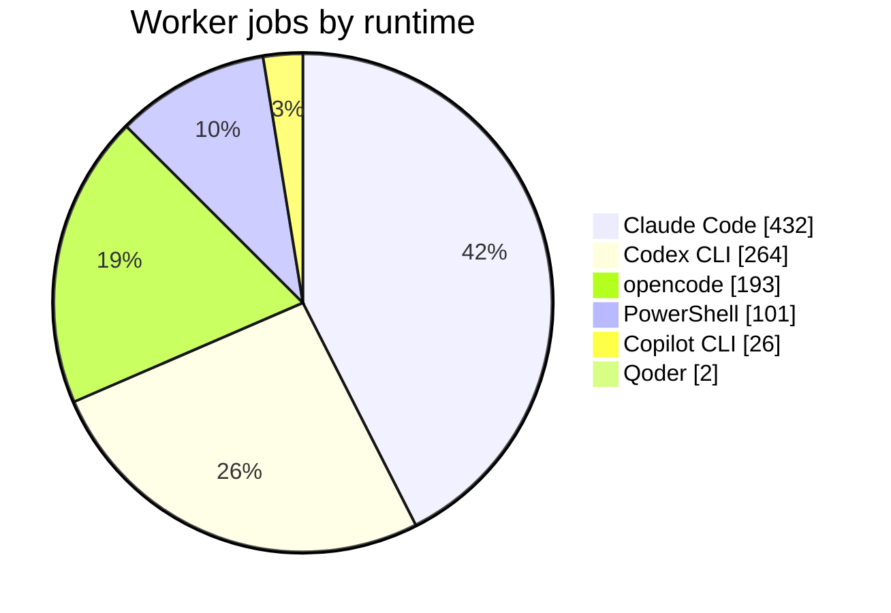
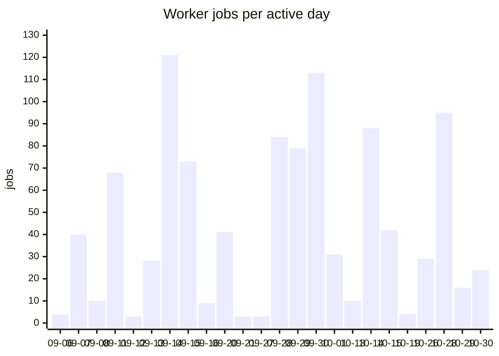

[← Longshot](../README.md) · [Harnesses & services](harnesses.md) · [Accounts](accounts.md) · [Telemetry](telemetry.md) · [SKILL.state](skill-state.md) · [Architecture](architecture.md) · **In numbers** · [Roadmap](roadmap.md)

# In numbers

**6 September – 30 October 2026**, from six mission databases: Longshot building itself (its
main checkout and two feature worktrees) and a private SaaS monorepo with a Python API, a React
web app and a Go desktop daemon (its main checkout and two feature worktrees). Historyless mode
became the default on 13 October, and OTel export landed on 30 October.

## Delegation

| KPI | Value |
|---|---|
| Worker jobs delegated | **1,018** |
| Task success rate | **98.8 %**: 886 completed, 11 failed on the task itself (10 of them shell checks that came back red) |
| Stopped before the task could succeed or fail, left out of the rate | 121: 42 provider refusals (quota, credits, expired key), 37 launch and integration bugs (most fixed since), 17 idle-watchdog kills, 10 lost in engine restarts, 15 cancelled |
| Worker agent-hours | **128 h** |
| Job duration, median / p90 / longest | 4 min / 17 min / 3.1 h |
| Peak parallel workers | **6** |
| Peak jobs in one day | **121** |
| Jobs fanned out from one coordinator thread | up to **225** |
| Isolated git worktrees created | **326** |
| Distinct worker models used | **26** |
| Runner accounts in the inventory | **11** (4 Codex, 3 Claude Code, one each for the rest) |

## The asynchronous loop

| KPI | Value |
|---|---|
| Coordinator threads | **66** (47 on Codex, 19 on Claude; 27 historyless) |
| Wake-ups driven by worker results | **925** confirmed of 1,000 attempted |
| Mailbox events persisted | **11,094** (7,707 delivered, 3,269 suppressed as noise, 73 pending, 45 failed) |
| Longest-lived coordinator thread | **≈ 11 days** (263 h from first to last turn) |
| Engine sessions | **107**, 326 h in total |
| Longest uninterrupted engine session | **35 h** |

## Tokens

| KPI | Value |
|---|---|
| Claude Code worker tokens | **1.80 B** in 418 jobs; 97 % cache reads; 38 % served by Ollama models |
| Claude Code agent turns | **21,273**, up to 312 in one job |
| Largest single job | 90 M tokens |
| Claude Code API list price, Anthropic accounts only | ≈ $699 |
| Codex CLI worker tokens | **588 M** in 205 jobs; 96 % cache reads; 43 more jobs left only a total (6.1 M) |
| Copilot CLI worker tokens | 47 M in 19 jobs, 19 premium requests |
| Coordinator tokens, full-history threads | **549 M** in 21 threads, measured on 15 October (316 M Codex, 233 M Claude) |

## The codebase

| KPI | Value |
|---|---|
| Commits | **687** in 57 days |
| Go, production | ≈ 118 k lines in 36 packages |
| Go, tests | ≈ 176 k lines, **5,906 tests passing** |
| Claude sidecar | ≈ 5 k lines of Node.js on the TypeScript Agent SDK |
| Direct Go dependencies | 5, all pure Go (no cgo) |
| Design docs, specs and task records | ≈ 191 k lines of Markdown, interface sentences pinned by tests |

596 of the 1,018 jobs ran on Longshot's own repository. **Longshot is largely built by Longshot.**

## How it was counted

- **Job:** one delegated worker process. Durations leave out `lost` jobs, whose end time only
  marks when recovery noticed them.
- **Task success rate:** completed jobs out of the jobs whose task reached an outcome. Every
  unsuccessful job is classified by the error it left: a provider refusal, a launch or
  integration bug, the idle watchdog (which until mid-September also killed Claude Code
  workers whose output was not streamed), a lost worker, or a cancellation. Counting every
  unsuccessful job as a failure gives 87.0 %.
- **Wake-up:** a coordinator turn started to deliver worker results, possibly a batch of them.
- **Engine session:** one mission lease, held by one engine process from start to exit.
- **Tokens:** input + cache reads + cache writes + output. Reasoning is part of output. The
  sources are Claude Code's `result` event, the Codex rollout (or the `tokens used` total when
  the rollout is gone) and Copilot's `session.shutdown`. opencode, Qoder and shell report no
  usage.
- **Coordinator tokens:** read from session files that the CLIs have pruned since 15 October,
  so that row is not recomputed. A historyless turn leaves no session file, so its usage now
  goes through the OTel export.
- **List price:** what Claude Code reports for Anthropic accounts, not money spent.
- **Databases:** a mission's database lives in its checkout. One worktree removed since the last
  count took its jobs with it, so a few October days read lower than before.
- **Tests:** passing cases, subtests included, in one `go test ./...` run. Lines: tracked files,
  without the vendored Codex checkout or generated schemas.
- Recomputed by [`kpi.py`](../kpi.py) against the mission databases.

---

[← Architecture](architecture.md) · [Roadmap →](roadmap.md)
