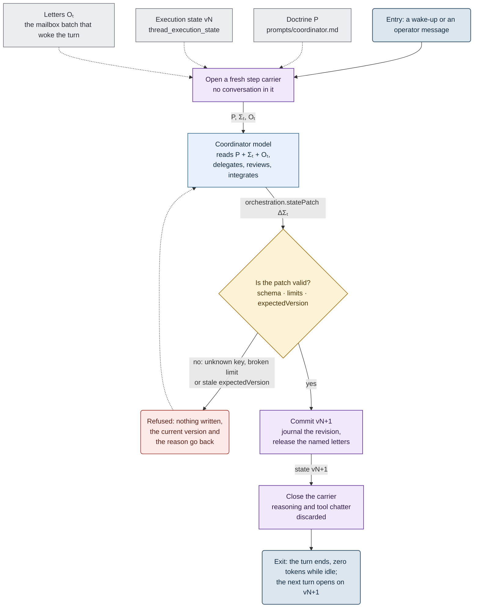
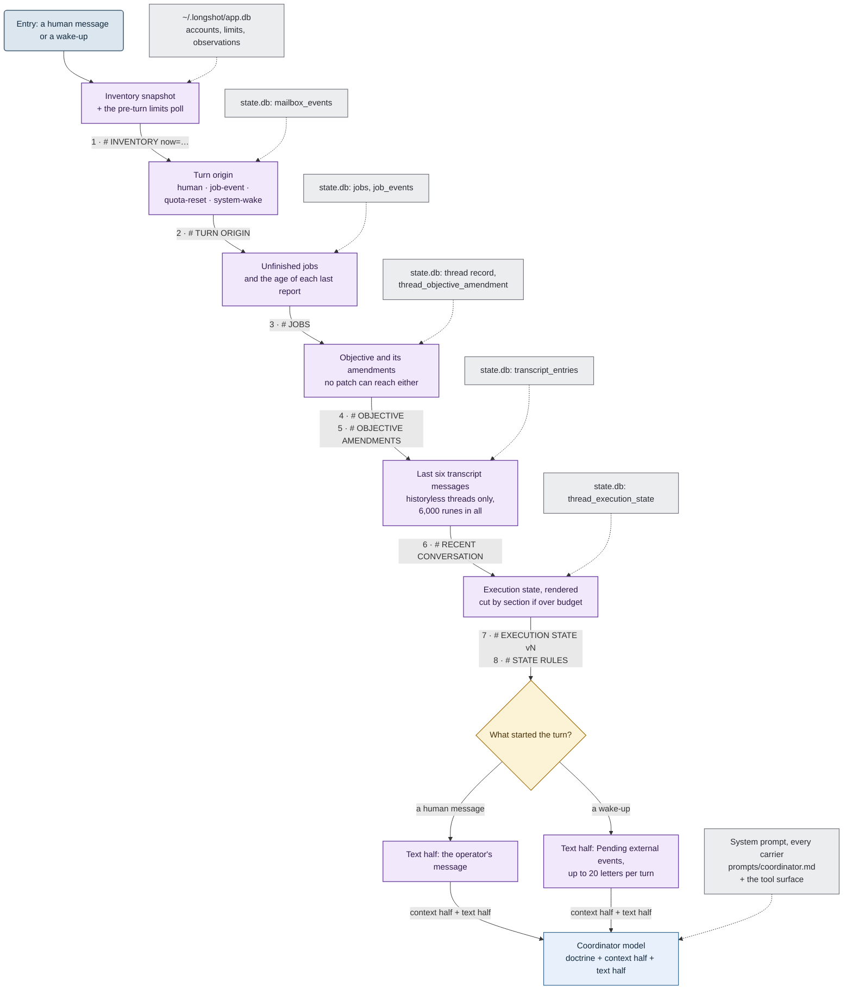

[← Longshot](../README.md) · [Harnesses & services](harnesses.md) · [Accounts](accounts.md) · [Telemetry](telemetry.md) · **SKILL.state** · [Architecture](architecture.md) · [In numbers](numbers.md) · [Roadmap](roadmap.md)

# SKILL.state: a coordinator without a memory

A coordinator that lives for days is idle most of the time:

```text
turn → delegate → END TURN → (idle: minutes, hours) → woken by events → turn → ...
```

The wake-up worked from the start. What did not was the memory of the step. Every turn ran on
the accumulated conversation, so after a day the prompt was mostly stale observations.

## The paper

*SKILL.state: Scalable Long-Horizon Agent Skills* (arXiv:2608.26263): an append-only history
costs `O(t)` per step and `O(T²)` in total, while an explicit state costs `O(1)` and `O(T)`. At
each step the model sees only the procedure `P`, the state `Σₜ` and the observation `Oₜ`.

| At horizon `T = 100` | History runtime | State runtime |
|---|---|---|
| Total tokens | 1,062,387 | **65,408** |
| Steps to recover after the external world drifts | 5–8 | **0** |

## How Longshot maps it

| The paper | Longshot |
|---|---|
| procedural spec `P` | the **doctrine**, `prompts/coordinator.md`, byte-identical on every carrier |
| state `Σₜ` | the **execution state**: one typed, versioned JSON document per thread |
| state patch `ΔΣₜ` | `orchestration.statePatch`: section replacements; `null` clears a section |
| step | one coordinator **turn** |
| observation `Oₜ` | the wake: mailbox letters plus the turn context |
| discarded reasoning | the **step carrier**: a backend session opened for one turn and closed after it |

The mode belongs to the thread and is fixed at its birth: `historyless` (the default) or
*full history*.

Diagrams use one [fixed vocabulary](diagrams.md).



## What the state holds

Nine sections, bounded by design. A state that grew with the turns would bring back the problem.

| Section | What goes in | Bound |
|---|---|---|
| `phase` | `investigate` → `plan` → `delegate` → `verify` → `report` | enum |
| `plan` | steps with `id`, `goal`, `status`, `dependsOn`; failed steps stay, so nobody retries them blindly | 64 items |
| `decisions` | named conclusions, and open questions as `asked:<topic>` | — |
| `notes` | conclusions, never the path to them; appended and numbered by the runtime | 16 × 256 runes |
| `blockers` | what the work waits on, by reference (`job:claude-42`) | — |
| `verification` | checks and their outcome | — |
| `artifactRefs` | branches, files, commits, as references | — |
| `nextActions` | what the next turn should do | 32 |
| `consumedEvents` | the `EventID` of every letter this turn handled | 64 |
| *any string* | | 512 runes |
| *whole document* | compact JSON | **128 Ki runes** |

The bound began at 8,192 characters. Real threads reached 8,187 of it, so it went up to
128 Ki runes. It is still a constant, not a function of the number of turns.

```text
# EXECUTION STATE v7

schemaVersion: 1
phase: delegate
consumedEvents: 2 ids in the current list

## plan
- S1 done: map the schema
- S2 running: migrate the users table (depends on: S1)

## decisions
- storage = sqlite

## notes
- #2 S2: migration must run before the API deploy
- #1 S1: the users table has no index on email

## blockers
- B1: waiting for the migration job (waiting on: job:claude-42)

## verification
- V1 pending: go test ./...

## artifactRefs
- branch: longshot/claude-42
```

## The rules that make it hold

- **Patch or lose it.** State moves forward only through `orchestration.statePatch`. Nothing
  parses prose.
- **Optimistic concurrency.** A stale `expectedVersion` is refused, with the current version.
- **All or nothing.** One bad key or limit refuses the whole patch. Each refusal is recorded
  with its reason.
- **Every version is kept.** `orchestration.stateHistory` answers *why the plan looks like
  this*.
- **Reference, never copy.** Jobs, worktrees and quotas live in their own stores. When the store
  and the state disagree, the store wins.
- **Handling is proved.** A letter leaves the queue only when a turn names it in
  `consumedEvents`. A turn that forgot gets it again.
- **A question is state.** It goes into `decisions` as `asked:<topic>`, so `1a 3b` still
  resolves turns later. `# RECENT CONVERSATION` is the backstop.
- **The objective is not state.** No patch can reach it. A redirection is recorded as `clarify`
  or `replace`, with the reason and the old wording.
- **No native subagents.** All delegation goes through `agents.spawn`. On Claude, `Agent` and
  `Task` are withheld.
- **A carrier is never resumed.** After a restart, a crash or a move, the next turn opens a new
  carrier from the state.

| | Full history | Historyless (SKILL.state) |
|---|---|---|
| Prompt size per turn | grows every turn | flat |
| Re-orientation after hours idle | re-read the conversation | read one state block |
| Restart mid-objective | resume the session, if it survived | open a new carrier |
| Move to another backend or account | replay the transcript | the state moves with the thread |
| Wake-up lost in a crash | possible | re-presented until named |

| In use since it became the default on 13 October | |
|---|---|
| Historyless coordinator threads | **27** of 66 |
| Execution-state revisions committed | **385** |
| Patches refused by validation, each with its reason | **34** |
| Objective amendments (`clarify` / `replace`) | **18** |

## What one turn sees

Assembled from durable sources on every turn, in a fixed order. Nothing is remembered;
everything is re-read.



- **A clock.** `now=` in the inventory header tells a thread how long it slept.
- **Progress without noise.** Running workers report only through `# JOBS`. Progress events do
  not wake the coordinator.
- **A failed source costs a line.** Every block reads under a deadline, and one that fails
  degrades to a one-line notice.
- **Batched wake-ups.** Up to 20 letters ride one turn. The window counts from the oldest letter.
- **Workers see none of this.** Each worker gets one self-contained task.

**Next: context fingerprints.** Skills, plugins, MCP servers and `AGENTS.md` that the backend
loads by itself change the next carrier silently. A per-turn hash of both halves will show what
changed between turn N-1 and turn N.

---

[← Telemetry](telemetry.md) · [Architecture →](architecture.md)
