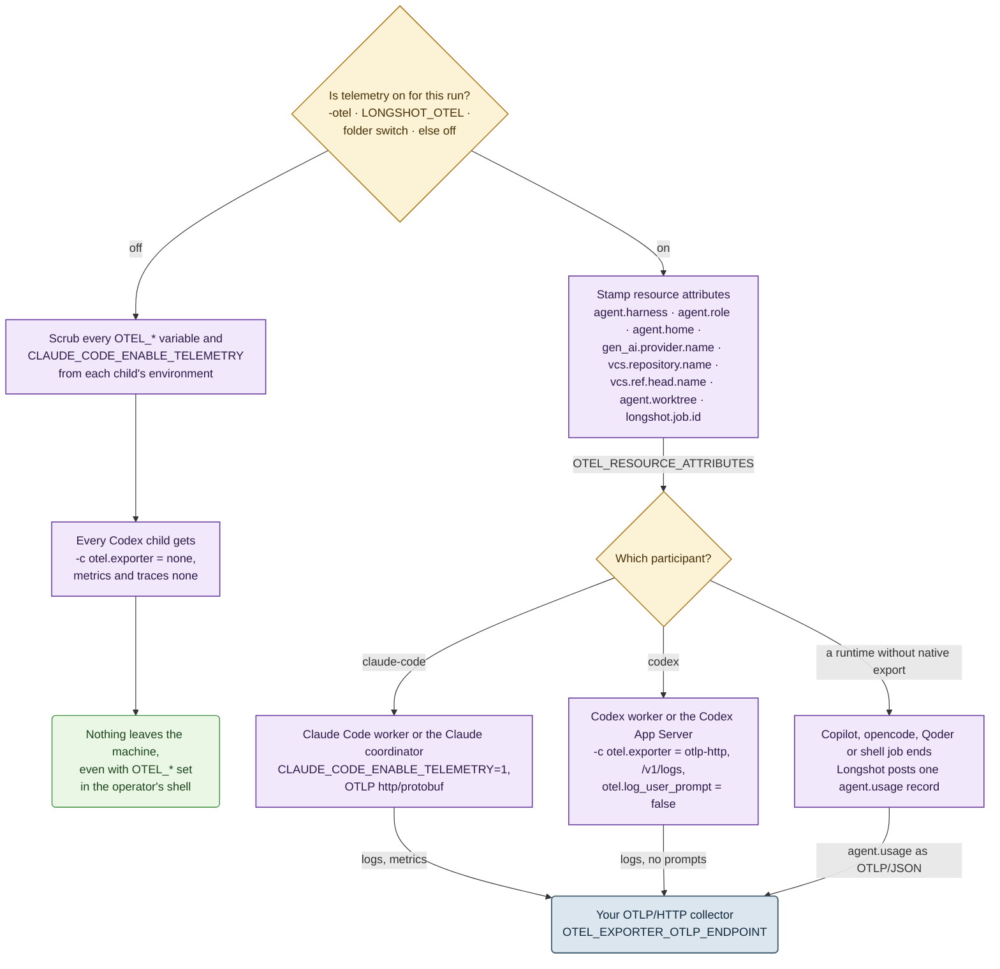

[← Longshot](../README.md) · [Harnesses & services](harnesses.md) · [Accounts](accounts.md) · **Telemetry** · [SKILL.state](skill-state.md) · [Architecture](architecture.md) · [In numbers](numbers.md) · [Roadmap](roadmap.md)

# Telemetry (OpenTelemetry)

Telemetry is off by default. Precedence, highest first:

1. `longshot -otel` for one run, or `-otel=false` to silence a folder that is saved on;
2. `LONGSHOT_OTEL=1`;
3. **Repository setup → Telemetry**, saved per folder;
4. otherwise off.

The endpoint is the standard `OTEL_EXPORTER_OTLP_ENDPOINT`, default `http://127.0.0.1:4318`.

Diagrams use one [fixed vocabulary](diagrams.md).



- **Off means off.** Longshot silences every child, so an inherited `OTEL_*` setting cannot leak
  out of a worker.
- **One set of labels.** Split usage by `agent.role` (`coordinator` / `job`), by `agent.home`
  (`codex:work`, `claude:ollama`, …), by repository and branch. Your own
  `OTEL_RESOURCE_ATTRIBUTES` are kept.
- **No silent gaps.** Claude Code and Codex export natively. Every other runner yields one
  `agent.usage` record per job, marked `usage.status=unavailable` with a reason when the job
  cannot be measured.
- **An honest header.** A chat shows `otel` while its coordinator exports. It shows
  `otel pending` or `otel off pending` until the coordinator's next process picks up the new
  value. New jobs follow the switch at once.

## Example stack

```sh
docker run -d --name lgtm -p 3000:3000 -p 4318:4318 grafana/otel-lgtm   # Grafana + Loki + Prometheus
OTEL_RESOURCE_ATTRIBUTES="task.id=release-42" longshot -otel            # your own label rides along
```

```logql
{service_name="longshot"} | event_name="agent.usage" | usage_status="unavailable"
```

---

[← Accounts](accounts.md) · [SKILL.state →](skill-state.md)
